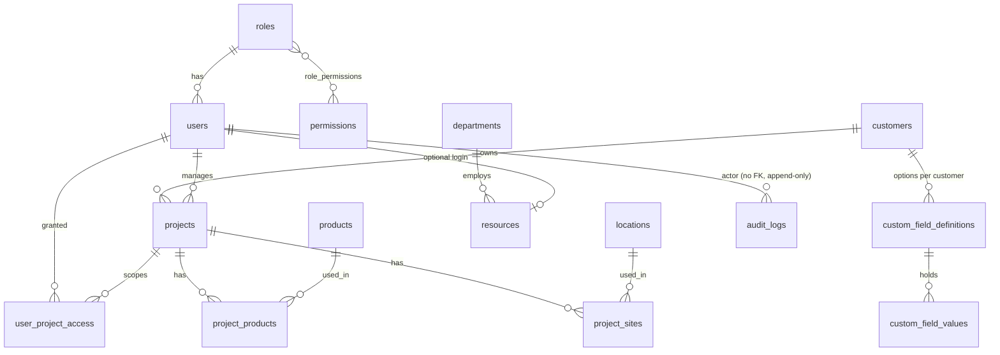
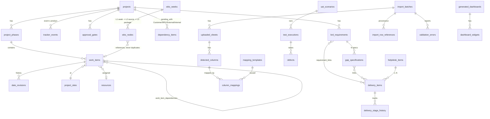

# Database ERD

PostgreSQL is the target. Phase 1 tables exist and migrate (`backend/alembic/versions/0001_phase_1_foundation.py`); later groups are the design agreed in the plan.
Rules: UUID primary keys; external references (Issue ID, Helpdesk ID, BRD serial) are separate non-unique columns; planned dates are baselines and revisions are appended; raw imported status is kept beside the normalized status; JSONB (JSON) only for audit snapshots, option lists and import provenance.

## Phase 1 (implemented)

## Planned groups (Phases 2-7)

## Constraints worth knowing (Phase 1)
- `customers.code`, `products.code`, `departments.code`, `locations.code`, `projects.code`, `users.email`: unique.
- `project_products(project_id, product_id)` and `project_sites(project_id, location_id)`: unique pairs.
- `custom_field_definitions`: slot 1..5, type in (dropdown, date, text), unique (customer, entity, type, slot); a partial unique index covers the NULL-customer (global) case because a plain UNIQUE ignores NULLs.
- `status_configs`: unique (entity_type, code); category in (not_started, in_progress, done, cancelled, blocked).
- Deleting a customer/product/location that is referenced returns 409 (use is_active=false instead).
